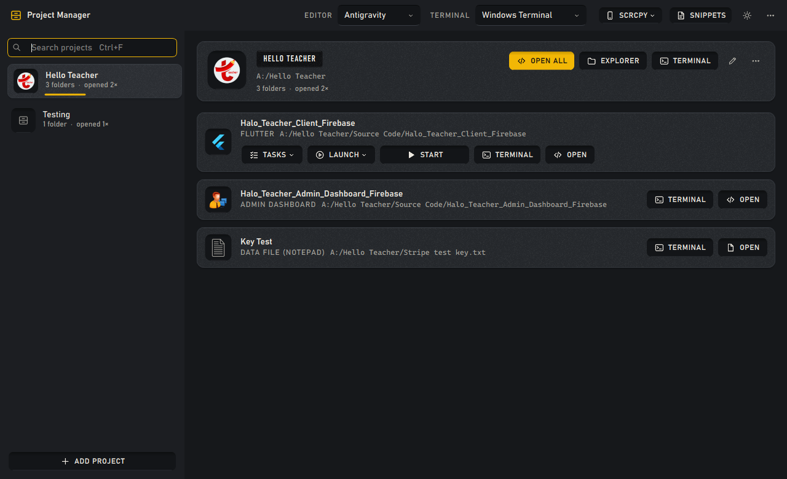
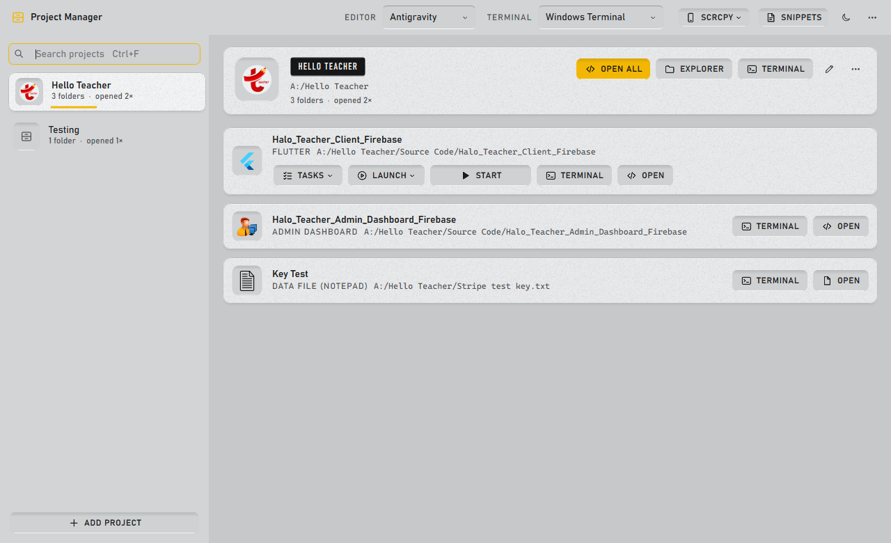
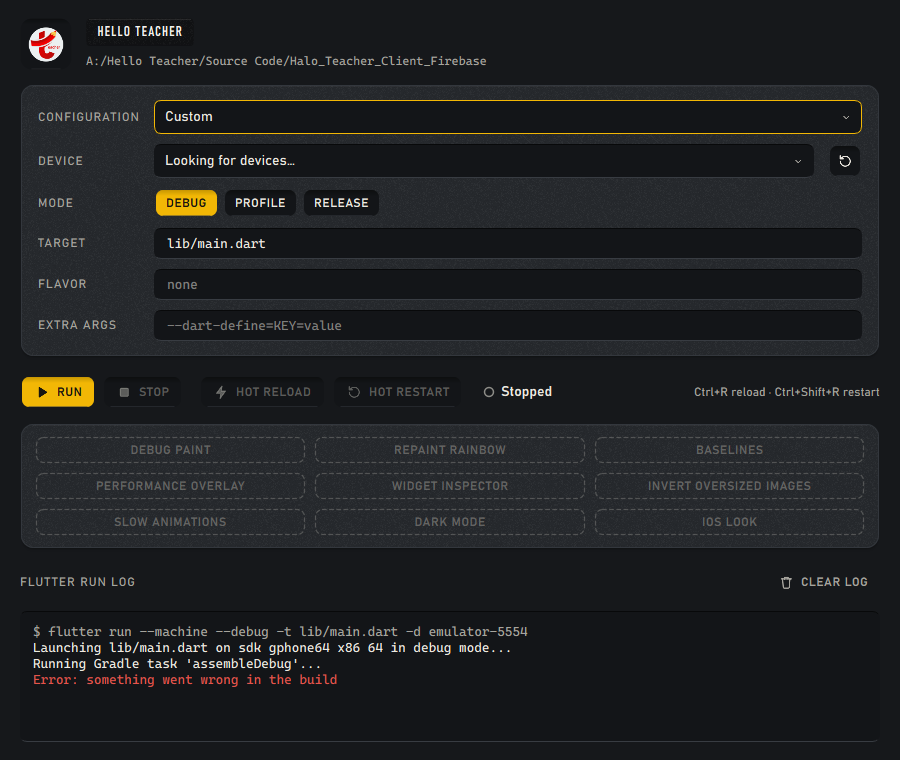

# Project Manager

A Windows desktop launcher for developers who juggle many projects. A project is a bundle of folders (a Flutter app, an admin dashboard, cloud functions, docs, loose files and links), and Project Manager opens any of them in your editor, terminal, browser or Flutter run console in one click.

Built with Python and PySide6 (Qt 6).



## Download

Get the latest version from the [Releases page](https://github.com/amsyary/ProjectManager/releases/latest):

- **`ProjectManager-Setup-x.y.z-x64.exe`**: the installer. It installs for your user only (no admin rights needed) and adds a Start-menu entry, an optional desktop shortcut and an uninstaller. Running a newer installer upgrades in place and keeps your projects and settings.
- **`ProjectManager-x.y.z-portable-x64.exe`**: a single file, nothing installed. It keeps its `data` and `config` folders next to itself.

Requires Windows 10 or 11 (64-bit); Windows on ARM runs it under x64 emulation. The downloads are not code-signed yet, so SmartScreen may warn on first run: choose **More info → Run anyway**.

## Purpose

Instead of navigating folders or remembering paths, open the app, type a few letters of the project name, and launch what you need: Cursor, VS Code or Antigravity, a terminal in your preferred shell, a saved command, a VS Code task, a launch configuration, or a full Flutter run with hot reload.

## Features

- **Projects as drawers** – The left rail lists your projects, most-opened first. The open project shows a header with its tools and one slot per folder, and each folder only shows the actions it can actually perform
- **Folder types** – Flutter, Admin Dashboard, Cloud Function, Web Version, Documentation, General, Data File (opens in Notepad), Execute / Open file (system default app) and Link (browser)
- **Quick open** – Open a folder in Cursor, VS Code or Antigravity, or "Open all" for the whole project. The main project folder opens in Explorer. Missing folders are flagged in red
- **Search** – Start typing anywhere in the project list; the first match opens straight away
- **Terminal** – Open any folder (or the main project folder) in Windows Terminal, PowerShell, PowerShell 7, Command Prompt or Git Bash
- **Commands** – Save terminal commands per folder (e.g. `npm run dev`, `npm run build`). Run one, pick from the Run menu, "Run all", or tick "Run when opened" to start it with Open / Open all
- **VS Code tasks** – Folders with a `.vscode/tasks.json` get a Tasks menu. Supports shell/process, npm and typescript tasks, `dependsOn` (incl. `sequence`), `${workspaceFolder}`/`${env:...}` and `${input:...}` prompts (promptString and pickString). Tasks run in the shell your editor's terminal uses, like VS Code
- **Launch / Flutter run** – Folders with a `.vscode/launch.json` or a Flutter `pubspec.yaml` get a Launch menu. Node, Python and plain Dart configurations run in a terminal (a `preLaunchTask` runs first). Flutter configurations open a run window with device, mode (debug / profile / release), target, flavor (auto-detected from Gradle) and extra args; launch.json fills these in (`program`, `flutterMode`, `deviceId`, `toolArgs`, `args`, `env`, `cwd`). While the app runs you get **Hot reload** (Ctrl+R), **Hot restart** (Ctrl+Shift+R), nine service-extension toggles (debug paint, repaint rainbow, baselines, performance overlay, widget inspector, invert oversized images, slow animations, dark mode, iOS look) and the live `flutter run` log. The window remembers each folder's settings
- **Start** – Flutter folders get a Start button that runs with the saved device and settings in one click. While the app builds or runs, the button shows its state and timer ("Building 0:42", "Running") and the project's drawer gets a yellow dot; click it to bring the run window forward
- **scrcpy** – Mirror a connected Android device or emulator from the top bar, or "Run on all". scrcpy runs without a console window; the button shows how many devices are mirroring (needs `scrcpy` and `adb` on PATH)
- **Snippets** – A side panel of saved text (keys, commands, anything you paste often) with one-click Copy
- **Dark and light themes** – Toggle in the top bar; the choice is saved and the Windows title bar follows it
- **Export / Import** – Back up your project list as JSON; import by merging or overwriting





## Keyboard

- Type anywhere in the project list, or press Ctrl+F, to search; Up/Down move through projects
- Enter on a project focuses its first tool (Open all); Enter again launches it. Ctrl+Enter opens all folders directly
- Double-click a folder row to open it
- Ctrl+N adds a project, Ctrl+E edits it, Delete removes it (asks first), F5 re-reads tasks/launch files
- In dialogs, Enter (or Ctrl+S) saves and Esc cancels
- In the Flutter window: Ctrl+R hot reload, Ctrl+Shift+R hot restart

## Requirements

- Windows 10 or 11
- Python 3.10+ (this machine uses `py`, Python 3.12)
- PySide6

## Installation

```bash
# Clone or download the project
cd ProjectManager

# Install dependencies
py -m pip install -r requirements.txt

# Run the app
py main.py
```

## Building a Windows Executable

```bash
py -m pip install pyinstaller
py -m PyInstaller --clean --noconfirm ProjectManager.spec
```

The executable will be in `dist/ProjectManager.exe`. The exe keeps its own `data/` and `config/` folders next to it, separate from the ones in the repository.

Or use the VS Code task: **Terminal → Run Task → Build: Windows executable**

To build the installer locally, build the folder version, then compile the Inno Setup script (needs [Inno Setup 6](https://jrsoftware.org/isinfo.php)):

```powershell
$env:PM_ONEDIR = "1"; py -m PyInstaller --clean --noconfirm ProjectManager.spec; $env:PM_ONEDIR = $null
iscc /DAppVersion=1.0.0 installer\ProjectManager.iss
```

The installer lands in `installer/Output/`.

## Releasing

Releases are built by GitHub Actions ([.github/workflows/release.yml](.github/workflows/release.yml)). To publish one, push a version tag:

```bash
git tag v1.0.0
git push origin v1.0.0
```

The workflow builds the portable exe and the installer on Windows, smoke-tests the app, and publishes a GitHub Release with both files and a `SHA256SUMS.txt`. Pull requests and manual runs (Actions → Build and release → Run workflow) build the same files as downloadable artifacts without publishing a release.

## Usage

1. **Add a project** – Click "Add project" (or Ctrl+N), enter a name, optionally pick an icon (an image file or one of the default icons) and a main folder, then add its folders with a type each.
2. **Open things** – Pick a project on the left. Use "Open all", or the Open / Terminal / Run / Tasks / Launch / Start tools on each folder.
3. **Editor and terminal** – Choose them in the top bar. Your choices are saved.
4. **Edit or delete** – Use the pencil or "…" on the project header, double-click or right-click a project in the list, or Ctrl+E / Delete.

## Project Structure

```
ProjectManager/
├── main.py              # Entry point
├── config/              # Settings (editor, terminal, theme, Flutter run settings)
├── data/                # Projects and snippets (projects.json)
├── assets/              # App icon (app.ico), folder type icons, default project icons
├── installer/           # Inno Setup script for the Windows installer
├── .github/workflows/   # Build and release workflow
├── models/              # Data models
├── services/            # Launchers, VS Code tasks/launch parsing, Flutter runner, scrcpy
├── ui/                  # PySide6 UI (theme.py holds the design tokens)
├── docs/screenshots/    # README screenshots
├── PRODUCT.md           # Product context
└── DESIGN.md            # Design system
```

## Icons

Folder type icons live in `assets/icons/` with these names:

- `flutter.png`, `admin_dashboard.png`, `cloud_function.png`, `web_version.png`
- `documentation.png`, `general.png`, `data_txt.png`, `execute.png`, `link.png`

Default project icons live in `assets/icons/default_icon/`.

## Author

**Amsyari**

Contact: [amsyary.skenza313@gmail.com](mailto:amsyary.skenza313@gmail.com)

## License

This project is licensed under the MIT License. See [LICENSE](LICENSE) for details.
